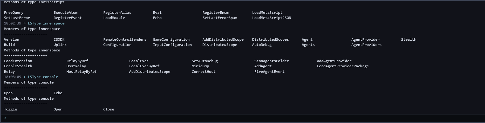
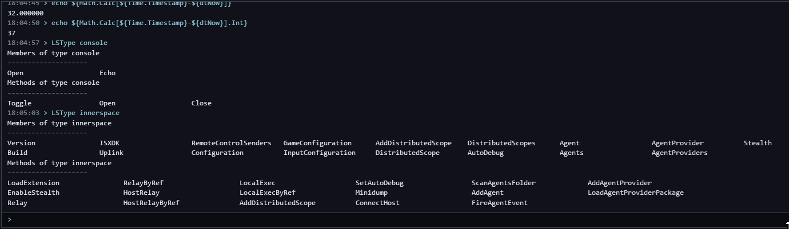

# LSConsole2

**An enhanced console for Inner Space clients.**

LSConsole2 is an Inner Space extension that adds a second, smarter console next to the stock one. It
completes what you type from what is actually loaded in the session: commands, top-level objects,
datatypes, members, methods, events, variables and the scripts on your PC. It also shows the live
values of the things you're completing, keeps a searchable history shared by every session, and
lets you search the output.

It works in game sessions and in the uplink, with or without other extensions loaded. It needs no
network access and no account.



---

## Features

- **Completion from the live session.** Lists come straight from LavishScript, so whatever your
  extensions register shows up:
  - commands and aliases;
  - top-level objects and datatypes;
  - members (after `.`) and methods (after `:`), on any chain such as `${Me.Target.` or
    `OgreBotAPI.Bot:`;
  - events inside `Event[...]`;
  - the variables visible from the console;
  - script names (`.iss`) after `run`, inside `Script[...]` and after `end`.
  - extensions after `ext` (all of them) and `ext -unload` (the loaded ones).
- **Brackets.** Typing `(`, `[` or `{` adds the closer, and the pair at the caret and the pair
  around it are highlighted, so `${Math.Calc[` becomes `${Math.Calc[]}` with the caret inside.
- **Live values.** Variables and members of basic types (string, int, float, bool…) show their
  current value next to the name, as in `Name (Stormfall)`. The value is shown only; it is never
  inserted.
- **Parameter hints.** For entries the console has metadata for, it shows a description, each form's
  parameters and what it returns. Accepting a completion fills in parameter placeholders, which
  you step through with Tab.
- **Command history.** History is saved, shared between all your sessions, and searchable: type
  `hist` followed by filter words.
- **Search the output** with Ctrl+F, using match case, regex, whole word, or "show only matching
  lines".
- **Copy and paste** with Ctrl+C / Ctrl+X / Ctrl+V, from the input line or the output. A paste of
  several lines is refused instead of running them.
- **A real window, always on top.** The console is a see-through window owned by the game window,
  so nothing drawn in the game covers it and your clicks reach it first. You can move and resize
  it, and each session remembers where you put it.
- **Stands in for the stock console.** While it's loaded, `console on`, `console off` and
  `console toggle`, and with them your console key, open and close LSConsole2. Unloading it hands
  them back.
- **Extensible metadata.** Extensions can publish descriptions and parameter info for their own
  datatypes and commands, and you can add or correct entries with a JSON file.
- **Exclusions.** `lsconsole2 exclude <text> [<replacement>]` keeps text out of completions, for
  example your character's name while recording a video.

It also searches the console output: **Ctrl+F** highlights every match and steps through them.



---

## Requirements

- Windows 10 or 11, 64-bit.
- Inner Space with the 64-bit (ISXDK 35) extension host.
- The game in **windowed or borderless** mode. Exclusive fullscreen is not supported: Windows
  can't show another window over it.

---

## Quick start

1. Download `LSConsole2.dll` from the [latest release](https://github.com/user01-x/lsconsole2/releases/latest)
   and copy it into your Inner Space
   `x64\Extensions\ISXDK35` folder (by default
   `C:\Program Files (x86)\InnerSpace\x64\Extensions\ISXDK35`). It's the only file: everything
   else it needs travels inside it.

2. In a session's console (or the uplink's), load it:

   ```
   ext LSConsole2
   ```

   Loading it closes the stock console and opens LSConsole2 in its place.

3. Press your console key (usually `` ` ``) to show or hide it. `console on`, `console off` and
   `console toggle` now work on LSConsole2, so scripts and UI buttons that open the console open
   this one.

   `console -stock on` (or `off`, `toggle`) still reaches the stock console. Unloading the
   extension (`ext -unload LSConsole2`) gives `console` back to Inner Space.

---

## Usage

### Running commands

Type a command and press **Enter**. Anything you could type in the stock console works here, and its
output appears in both consoles. **Up / Down** on an empty list step through your history.
**Esc** clears the input line.

Each command you run is echoed with the time you entered it. `consoleclear` typed by itself clears
LSConsole2's output.

### Brackets

- Typing `(`, `[` or `{` adds its closer after the caret, when the caret is at the end of the line,
  before a space or before another closer. With text selected, it wraps the selection instead.
- Typing a closer that is already next steps over it, and so does **Tab** when no list is open (or
  when the highlighted entry is already typed in full).
- **Backspace** between an empty pair removes both.
- The pair touching the caret is highlighted in yellow, the pair around the caret in blue, and an
  unmatched bracket is red.

### Completion

The list appears above the input line as you type, with the best match next to it. Names that
start with what you typed in the same case rank first, then in any case, then names that contain
it; the shortest name wins a tie.

| Key | Does |
|---|---|
| **Tab** or **Enter** | accept the highlighted entry (Enter runs the line if the entry is already typed in full) |
| **Up / Down**, **PgUp / PgDn** | move through the list |
| **Esc** | hide the list until you clear the line |
| **Alt+Enter** | show the list again |

Where completion looks:

| You type | It lists |
|---|---|
| the first word | commands, aliases, top-level objects and variables |
| `${` … | top-level objects and variables |
| `Me.` or `${Me.` | members of the type it resolves to |
| `Me:` or `${Me:` | methods |
| `${Me.Target.Name.` | members along any chain, using each step's actual type |
| `declare x ` or `lstype ` | datatypes |
| `Event[` | events |
| `${Script[name].VariableScope.` | that script's variables, read when you get there, plus the scope's members |
| `run `, `Script[`, `end ` | script names |
| `ext ` … `extension ` | the extensions in Inner Space's extensions folder, loaded ones marked |
| `ext -unload ` | the extensions loaded now |
| `relay all ` … | everything above again, for the relayed command |

Entries the metadata documents but the session doesn't have (for example from an extension that
isn't loaded) are shown greyed out with a warning sign.

### Parameters

Accepting a member, method, object or command with known parameters fills in placeholders:

- **Tab / Shift+Tab** move between them.
- Typing replaces the selected one.
- **Esc** removes the remaining parameters (the commas for members and methods, the spaces for
  commands), and with them any empty `[]`.

The hint above the input line shows the form you are in and its return type.

### History

Every command you run is saved, and all sessions on the PC share the same history.

- `hist` (or `histo`, … `history`) as the first word lists your history, newest next to the input
  line.
- Words after it filter the list. Every word must match (case doesn't matter), and `"quoted
  words"` match as one piece:

  ```
  hist relay ogre          -> lines containing both "relay" and "ogre"
  hist "run Ogre"          -> lines containing "run ogre"
  ```

- Tab or Enter puts the chosen line in the input without running it.

### Find

**Ctrl+F** opens the find bar over the output.

| Key | Does |
|---|---|
| **Enter / Shift+Enter** | previous / next match |
| **Alt+C** | match case |
| **Alt+W** | whole word |
| **Alt+R** | regular expression |
| **Alt+F** | show only the matching lines |
| **Esc** | close find |

### Copy and paste

- Click the console to give it the keyboard, and click the game to give it back.
- **Ctrl+C** copies the selection, from the input line or the output. **Ctrl+X** also cuts it from
  the input line. **Right-click** on the output copies the selection, or the clicked line.
- **Ctrl+V** and **Shift+Insert** paste a single line. Text with several lines is refused with a
  message, so a stray paste never runs a block of commands.

### Moving and resizing

- Drag the **top edge** to move the console. If the top is off screen, drag the bottom edge instead.
- Drag any **other edge or corner** to resize it.
- Each session remembers its own position and size.

---

## Commands

| Command | Does |
|---|---|
| `lsconsole2` | show or hide the console (same as `lsconsole2 toggle`) |
| `lsconsole2 show` / `lsconsole2 hide` | show / hide it |
| `lsconsole2 status` | version, window state, captured lines, and whether `console` opens LSConsole2 |
| `lsconsole2 meta` | which metadata loaded, from where, and any problems with it |
| `lsconsole2 meta reload` | reload the metadata (after editing a file in `ConsoleMetadata`) |
| `lsconsole2 meta check` | compare the metadata against what's live in the session and write a report |
| `lsconsole2 exclude <text>` | leave out completions containing the text, and value previews containing it |
| `lsconsole2 exclude <text> <replacement>` | show the replacement in place of the text in completions and value previews |
| `lsconsole2 exclude` | list the exclusions (they last until the extension unloads) |
| `console on\|off\|toggle` | show, hide or toggle LSConsole2 while it's loaded |
| `console -stock <...>` | the stock `console` command, for example `console -stock on` |
| `consoleclear` | typed in LSConsole2, clears its output |

---

## Console metadata

The live session knows *which* members, methods and commands exist. Metadata adds *how to use
them*: descriptions, parameters, the forms an entry accepts, and what each form returns. It comes
from three places, and a later one overrides an earlier one field by field:

1. **Built in.** LavishScript and Inner Space basics, bundled into the extension.
2. **Published by an extension.** If a loaded extension's top-level object has a `ConsoleMetadata`
   member returning a `jsonvalue`, LSConsole2 imports it. LSConsole2 checks that the member exists
   through the SDK first, so extensions without it never see an error.
3. **Your own files.** Any `*.json` in `x64\Extensions\ConsoleMetadata\`. Use them to document a
   script's commands or to fix an entry.

A small example:

```json
{
  "schema": 1,
  "name": "MyExtension",
  "types": {
    "widget": {
      "description": "A widget.",
      "members": {
        "Name": { "description": "Its name.", "forms": [{ "returns": "string" }] },
        "Part": {
          "forms": [
            { "params": [{ "name": "index", "type": "int" }], "returns": "widgetpart" },
            { "params": [{ "name": "name", "type": "string" }], "returns": "widgetpart" }
          ]
        }
      },
      "methods": { "Spin": { "description": "Spins it.", "forms": [{}] } }
    }
  },
  "commands": {
    "spinall": { "description": "Spins every widget.", "forms": [{ "params": [{ "name": "speed", "type": "int", "optional": true }] }] }
  }
}
```

### Schema reference

A document is an object with `"schema": 1` and any of `types`, `objects`, `commands` and `events`.
`name` and `version` are optional labels, shown by `lsconsole2 meta`.

- **`types`**: datatypes by name, each with `description`, `inherits`, and `members` / `methods`
  (entries by name).
- **`objects`**: top-level objects by name (entries).
- **`commands`**: commands by name (entries).
- **`events`**: events by name, each with `description` and `params`.

**An entry** (member, method, object, command):

| Field | Meaning |
|---|---|
| `description` | shown for the highlighted completion |
| `forms` | one or more; each form is one way to call it. Leaving it out means one form with no parameters |
| `deprecated` | what to use instead |

A command entry can also have:

| Field | Meaning |
|---|---|
| `subcommands` | entries keyed by the word that selects them, each with everything a command has, its own `subcommands` included |
| `also` | other spellings sharing the entry, e.g. `!ci` beside `!c` |
| `abbreviate` | the shortest abbreviation accepted (`3` lets `ext` stand for `Extension`). Without it, only the full name matches |

**A form**: `params` (in order), `returns` (a type name, for members and objects), `description`.

**A parameter**:

| Field | Meaning |
|---|---|
| `name` | shown in the hint and inserted as its placeholder |
| `type` | a type name, for the hint |
| `optional` | may be left out |
| `repeat` | may be given any number of times (the last parameter only) |
| `values` | the allowed values, offered as a completion list |
| `source` | a list the console already has: `files`, `scripts`, `types`, `events`, `variables`, `objects`, `commands`, `aliases` |
| `literal` | a fixed word (a flag like `-delete`), not a placeholder |
| `description` | shown in the hint for that parameter |

Commands separate arguments with spaces. Members, methods and objects take them in `[...]`,
separated by commas.

A command with sub-commands:

```json
"commands": {
  "oc": {
    "subcommands": {
      "!c": {
        "also": ["!ci"],
        "subcommands": {
          "-Jump": { "description": "Jumps.", "forms": [{ "params": [{ "name": "forwho" }] }] }
        }
      }
    }
  }
}
```

After editing a file, run `lsconsole2 meta reload`. To see where your metadata and the live session
disagree, run `lsconsole2 meta check`.

---

## How it works

```
game or uplink process                                   LSConsole2Host.exe (one per PC)
┌──────────────────────────────────────────┐            ┌──────────────────────────────┐
│ LSConsole2.dll                           │   pipe     │ Ultralight (HTML/CSS, CPU)   │
│  · captures every console line           │◄──────────►│  one view per session        │
│  · answers completion queries            │   JSON     │  renders the console page    │
│  · runs the commands you enter           │            │  keeps history and clipboard │
│  · owns a see-through window over the    │◄───────────│ writes pixels to shared mem  │
│    game and forwards mouse and keyboard  │ shared mem │                              │
└──────────────────────────────────────────┘            └──────────────────────────────┘
```

- **The renderer runs in its own process.** No browser engine loads into the game, so it can't
  clash with other extensions that bring their own, and a renderer crash can't take the game down.
  The host starts with the first session and exits a few minutes after the last one closes.
- **The console is an ordinary Windows window** owned by the game (or uplink) window. Windows draws
  it over the game, so it needs no Direct3D hooks, no input hooks and no LavishGUI.
- **One file to install.** The host, Ultralight and the console page travel inside
  `LSConsole2.dll`, compressed. The first time a version loads, it unpacks them into
  `%LOCALAPPDATA%\LSConsole2\runtime\<version>\` (about a second, off the game's thread); later loads
  find them there. A newer version unpacks beside the old one and uses its own host, so updating
  never needs the old host stopped first; old versions are removed once nothing runs from them.
- History, layouts and the host's log live in `%LOCALAPPDATA%\LSConsole2`.

---

## Building from source

You need Visual Studio 2026 (toolset v145), 7-Zip, and the ISXDK 35 SDK.

```powershell
.\build.ps1                      # fetches the Ultralight SDK on first run, builds dist\LSConsole2.dll
.\build.ps1 /p:ISXDKDir=C:\...   # if the ISXDK is elsewhere (or set the ISXDKDir environment variable)
.\deploy.ps1                     # copies it into InnerSpace\x64\Extensions\ISXDK35 (needs admin)
```

Unload the extension in every session (`ext -unload LSConsole2`) before deploying, or the DLL is
locked.

| Path | What |
|---|---|
| `src/ext` | the Inner Space extension (ISXDK 35) |
| `src/host` | the render host (Ultralight) |
| `src/common` | the pipe and the wire protocol |
| `src/page` | the console page (HTML, CSS, JavaScript) |
| `src/metadata` | the built-in metadata |
| `src/harness` | runs the window and host over a fake game window, for testing without Inner Space |
| `tests` | completion, history and placeholder tests: `node tests/completion.test.js src/page/console.html` |
| `tools` | Ultralight download, runtime packing, built-in metadata generator |

Building the extension packs the host's runtime first (`tools/pack-runtime.ps1`, run by the
project before it compiles): the host, Ultralight and the page are staged in
`build\x64\Release\runtime\` and compressed into the DLL. The harness runs the host from that staged
folder.

---

## Notes

- **Elevation.** Sessions running as administrator and sessions that aren't can share one host.
- **Other consoles.** The stock console keeps working, and output appears in both.
- **Ogre and other UI extensions.** LSConsole2 doesn't depend on them or interact with them, and
  they can be loaded before or after it.

## Licences

- **LSConsole2** itself is released into the public domain ([The Unlicense](LICENSE)).
- **Ultralight** is not in this repository. `tools/fetch-ultralight.ps1` downloads the free SDK.
  Its licence (`third_party/ultralight/license/LICENSE.txt`, carried inside `LSConsole2.dll` and
  unpacked with the runtime) allows free
  distribution, including commercial use, for individuals and for companies under US$100,000
  annual turnover.
- **[nlohmann/json](https://github.com/nlohmann/json)** is MIT licensed.
